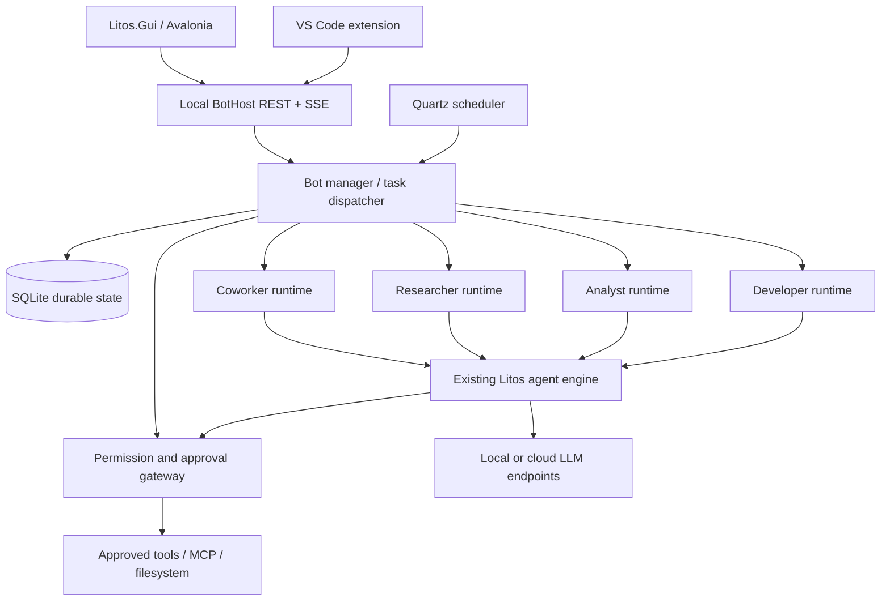

# Litos Work

**Your personal AI workforce — local-first, model-independent, and built on Litos.**

Featuring **Litos Buzzies — Busy so you don't have to be.**

Status: Minimum Wow Product (private beta) + expansion roadmap | Target: .NET 10 / Avalonia

## 1. Executive summary

Litos Work is the user-facing evolution of `Litos.Gui`, extending the existing Litos AI coding agent into a general-purpose desktop environment for persistent AI coworkers. Users can create named bots, assign work, collaborate across agents, generate real artifacts and automate recurring tasks. The default Coworker is the primary conversational interface and coordinator.

The core strategy is to reuse the existing Litos agent engine, provider integrations, MCP support, tools and JSONL sessions. Introduce a shared local BotHost, rather than building a new agent engine or a separate server for every bot. Keep VS Code as the developer-facing interface and make Avalonia the primary frontend for general-purpose work.

### Branding: Litos Buzzies

**Litos Buzzies** is the proposed customer-facing name for the autonomous AI coworkers within Litos Work. Keep Litos Work as the desktop product name and use Buzzies as the friendly identity for its persistent agents. A single agent is a **Buzzy**.

| Concept | Customer-facing name |
|---|---|
| Desktop application | Litos Work |
| Autonomous AI agents | Litos Buzzies (or Buzzies) |
| Individual agent | Buzzy |
| Default personal coworker | My Buzzy (Coworker) |
| Team of agents | My Hive |
| Create an agent | Create a Buzzy |
| Future bot marketplace | Buzzy Store |

**Tagline:** Busy so you don't have to be.

**Product promise:** Your personal team of AI coworkers that remember, collaborate, learn approved workflows and get things done.

Use friendly, professional UI copy: “Create a Buzzy to monitor my servers”, “Your Buzzies completed five tasks today”, and “Meet your new Buzzy, Alex.” A restrained bee-inspired yellow-and-charcoal accent palette and simple mascot are optional visual directions, not MVP engineering requirements. Retain explicit status and approval indicators; never imply that idle agents are actively working or that an offline computer can execute tasks.

Keep internal names such as `BotHost`, `BotRuntime`, `BotConfiguration`, database schemas and `/api/bots` unchanged. Buzzies is a presentation and marketing identity, not a separate runtime or a change to the architecture. The beta templates are Buddy, Scout and Builder; Analyst is a later specialist template. Keep clear functional labels such as Tasks, Routines, Skills, Memory and Artifacts for discoverability.

Treat the name as provisional until trademark clearance and marketplace/domain checks are complete, especially for similar Buzzy/Buzzies AI products in India and intended international markets. No trademark availability is asserted here.

### Product boundaries

| Product | Purpose |
|---|---|
| Litos Work (`Litos.Gui`) | Desktop AI coworker and workforce, powered by Litos Buzzies |
| Litos Code (VS Code extension) | Interactive coding and access to shared bots |
| Litos Factory | Isolated, parallel software development tasks; later integration |
| Litos CLI / API | Programmable access to shared agent capabilities |

The initial customer is a developer, consultant or small-business owner who repeatedly works with local documents, research and software projects. Do not try to replace every office application in V1.

## 1A. Minimum Wow Product — authoritative launch scope

**Build the smallest product that remembers, executes and repeats.** This section and the revised section 9 supersede any broader V1 requirements elsewhere in this document. Sections 2–8 describe the longer-term architecture and experience, not mandatory first-release features. Keep Litos Work as the application and Litos Buzzies as the agent branding.

### Five capabilities

| Capability | First-release implementation |
|---|---|
| Create a Buzzy | Natural-language creation with a confirmation card for name, role, model, tools and workspace |
| Persistent memory | Per-Buzzy identity, editable memory and existing JSONL session history |
| Private workspace | Own working files, skills and artifacts; explicit grants for external folders |
| Scheduled execution | Manual, daily and weekly routines; run now, pause, cancel and next-run display |
| Gmail connector | Read/search messages, summarize, retrieve approved attachments and prepare replies; sending only with explicit approval if implemented |

Reuse the existing Litos agent, provider configurations, local model support, web search, file tools and Avalonia chat components. Add trusted structured document tools where needed (e.g., ClosedXML for XLSX). Do not require a new agent framework or one REST port per Buzzy.

### Three preinstalled templates

| Name | Role | Example |
|---|---|---|
| Buddy (My Buzzy) | Personal coworker | Morning email briefing and document processing |
| Scout | Researcher | Daily research report on new AI models |
| Builder | Developer | Interactive coding and supervised repository review |

Templates are editable and instantiated on demand. Multiple configured Buzzies are supported; start with one active task per Buzzy and one concurrent local inference request. A global concurrency limit of three is a proposed default, subject to engine testing. Free-tier limits apply only when paid licensing is launched.

### First-release desktop experience

```text
+-------------------+----------------------------------------+
| LITOS WORK        | My Buzzy (Buddy)                       |
| MY BUZZIES        | While you were away...                 |
| Buddy             | 3 important emails identified          |
| Scout - working   | 2 suggested replies prepared           |
| Builder - idle    | Research_Report.md ready               |
| + Create a Buzzy  | [Open report] [Review replies]         |
| Routines          |                                        |
| Artifacts         | [Remember This Workflow]               |
| Activity          | [Repeat Every Friday]                  |
| Connectors        | [What shall we work on today?] [Send]  |
+-------------------+----------------------------------------+
```

Reuse chat, show real task status, artifact links and approval cards. Use the system tray and notifications; keep full dashboards, embedded document viewers and team management for later. Creating a Buzzy or a routine through natural language must show the proposed settings for confirmation before saving.

### Minimal runtime and persistence

```text
Litos.Gui (Avalonia, stays alive in tray)
  BuzzyManager
    Buddy / Scout / Builder (independent Litos agent sessions)
  Shared scheduler, SQLite task state, permission gateway
  Trusted Gmail broker, native file/document tools, LLM providers
```

Run BuzzyManager and scheduler inside the GUI process for the private beta. No separate BotHost service, REST/SSE server or VS Code integration is required. Keep internal interfaces suitable for extracting BotHost later. Run routines only while the app process is alive, the computer is awake and required providers are available. Clearly distinguish minimize-to-tray from Quit. On restart or wake, record missed runs; skip by default or run one catch-up if explicitly enabled. Persist occurrence keys to prevent duplicate execution. Use a per-user lock, cancellation and per-task time/token limits.

```text
~/.litos/buzzies/<buzzy-id>/
  SOUL.md
  MEMORY.md
  skills/
  workspace/
  sessions/
  artifacts/
~/.litos/buzzies/buzzies.db
```

Use the OS-appropriate app-data location. SQLite is authoritative for configuration, permissions, schedules, task status and artifact metadata; an optional config.json export is not a second writable source of truth. Existing JSONL is authoritative for session logs. No vector database, Redis, external message broker or Docker. Existing BOT.md naming can be retained if already used by the engine rather than introducing duplicate identity files.

### Minimal security (mandatory)

- Interactive Builder may use existing shell tools with explicit human approval; verify the current implementation before reuse. Unattended shell, arbitrary Python/C# execution and untrusted executable MCP tools are disabled. No unrestricted fallback.
- Scheduled work can use only allowlisted trusted tools, per-Buzzy workspace and explicitly authorized folders. Enforce path and operation grants, including traversal and symlink/reparse-point escapes. These are application-enforced restrictions, not OS sandboxing.
- Gmail uses OAuth with narrowly scoped permissions; keep credentials in the OS secure store or trusted broker, never in prompts or bot files. Treat email, attachments and web text as untrusted data. Draft replies locally if possible; do not send without specific approval. Do not automatically delete mail.
- Persist approvals, prevent duplicate external writes and surface interrupted tasks instead of blindly retrying uncertain side effects. Review cloud-model data exposure with users.
- Gmail public OAuth verification and possible security assessment are external launch dependencies; test with authorized development accounts first. If blocked, demonstrate with sample email data clearly labelled as fixtures, not a live connector.

### Learn This Workflow: signature feature

After a successful task, offer **Open Artifact**, **Remember This Workflow**, and **Repeat Every Friday** (or another chosen schedule). Save a reviewed, versioned skill containing inputs, steps, tool grants, output and validation criteria. Show the user the generated skill and routine before enabling. Do not store secrets or untrusted instructions as memory. A repeated task should create a new artifact without overwriting prior results by default.

### Connector and marketplace roadmap

Gmail is the only built-in external account connector required for this beta. Google Drive and Google Calendar are the next two free connectors, sharing Google OAuth infrastructure where practical, with separate scopes and grants. X.com is a later premium/BYO-credentials connector; verify API costs and terms before shipping. A curated Buzzy Store for free and paid connectors, skills, workflows and complete Buzzies is a later release; no marketplace backend or seller payouts in the MVP. Existing local tools are not counted as new connectors.

### Deferred execution isolation

No MXC, Docker, VM or custom OS sandbox is required for this beta. Keep a future sandbox executor interface in mind, but only add it after demand for unattended arbitrary code is validated. Evaluate Microsoft MXC on Windows and macOS at that time, testing actual backend capabilities; do not equate workspace restrictions with OS isolation.

### The 60-second demonstration

1. Create Scout by conversation: research new open-source models suitable for my Mac every morning, and save a report. Confirm and run now.
2. Ask Buddy to summarize Gmail messages and prepare replies or process approved invoice attachments into a validated workbook.
3. Open the artifact, choose Remember This Workflow, review the skill, and schedule the task every Friday.
4. Minimize to tray and show a real completion notification after a test routine runs. Use a short test interval for the demo, not a fabricated overnight execution.

The outcome to validate is that a user teaches a useful task once, and the Buzzy performs it again without the user retyping the prompt.

## 2. Expanded product experience (post-beta)

### Main window

```text
+----------------------+--------------------------------------------+
| LITOS WORK           | Good morning                               |
| Home                 | 2 running | 3 completed | 1 approval       |
| Coworker             |                                            |
| MY BUZZIES           | Active work                                |
| Researcher           | Researcher: comparing hosting options      |
| Developer            | Analyst: validating invoice spreadsheet    |
| Analyst              |                                            |
| + Create a Buzzy     | Recent artifacts                           |
|                      | GPU-cost-comparison.xlsx                   |
| Tasks                | Weekly-research.md                         |
| Routines             |                                            |
| Artifacts            | [What would you like your team to do?]     |
| Skills & Memory      | [Attach files] [Choose folder] [Send]       |
| Approvals / Activity |                                            |
| Settings             | Local host: connected                       |
+----------------------+--------------------------------------------+
```

Use Avalonia MVVM and existing Litos chat components. Provide a task detail pane showing the current phase, tool calls, delegation graph, elapsed time, token usage, artifacts and approvals. Avoid invented percentage-complete indicators: show actual steps and status. A system tray icon, desktop notifications and optional start-at-login make the application convenient while the window is closed. Start with Windows and macOS; validate Linux separately.

### Onboarding

1. Connect an existing cloud provider or local LM Studio/Ollama endpoint, or select a bundled cloud plan when available.
2. Create a Coworker with a private default workspace.
3. Grant access to specific folders using explicit read/write permissions.
4. Run a guided first task (e.g., summarize a folder of documents).
5. Preview the resulting artifact and optionally save the workflow as a skill or routine.

### Built-in Buzzies (bot templates)

| Bot | Primary role | Initial tools |
|---|---|---|
| Coworker | Daily assistance, tasks, memory, delegation | Files, tasks, delegation, artifacts |
| Researcher | Research with sources and recurring briefings | Web search, read/write workspace |
| Developer | Repository review and coding | Git, shell under restricted policy, existing coding tools |
| Analyst | Excel, CSV and PDF processing | Structured document tools, workspace files |

Every bot is an ordinary runtime instance with a role-specific configuration. Coworker is not a separate agent engine. Templates can be edited or duplicated; do not enable all specialist bots or grant broad permissions automatically.

## 3. Signature workflows

### Learn this workflow

After a successful task, present **Save as Skill**, **Schedule Routine**, and **Repeat Task**. Generate a draft skill containing inputs, steps, tool requirements, output schema, validation criteria and known limitations. Show it to the user for review before activation. Keep versions; existing routines pin a skill version until approved for upgrade. Teaching another bot can be deferred until after V1.

### Example: invoice processing

The user grants access to an invoice folder and supplies business rules. Coworker delegates extraction to Analyst, validates required fields, detects duplicate invoice numbers and produces an XLSX report plus an exceptions sheet. Monetary totals and tax calculations use deterministic C# code, not LLM arithmetic. Uncertain fields are flagged for review. The user saves the workflow and schedules it every Friday. No tax return is filed or payment made automatically.

### Example: repository intelligence

Researcher identifies relevant .NET libraries with dated sources. Developer examines the approved repository in read-only mode, evaluates fit and returns evidence. Coworker consolidates findings into a report and proposes implementation tasks. Coding changes require a separate authorized task and an isolated Git worktree.

## 4. Target architecture (post-beta shared BotHost)



After the private beta, one BotHost process and one dynamically discovered local API endpoint are sufficient for the shared-host release. Each bot has independent session state, configuration, task queue and memory. Agents share code and provider clients where thread-safe; they never share mutable conversation state. Use asynchronous execution rather than dedicating an OS thread per bot. Instantiate agents lazily and dispose idle resources where possible. Idle bots incur no inference requests.

BotHost continues running when GUI or VS Code closes, provided the computer is awake and required services are available. It does not run while the machine is powered off. Use a per-user background process, optional login startup and an explicit Stop BotHost command. Prevent duplicate hosts with a per-user lock. On macOS use a user LaunchAgent where appropriate; avoid privileged system services for ordinary desktop access.

### Suggested projects

```text
Litos.Gui                  # Existing Avalonia frontend
Litos.Bot.Core             # Domain contracts, runtime, task state
Litos.Bot.Host             # ASP.NET Core host + background workers
Litos.Bot.Persistence      # SQLite repositories, migrations
Litos.Bot.Tools            # Delegation, memory, tasks, artifacts
Litos.Work.Documents       # Structured office document operations
Litos.Bot.Client           # REST/SSE client for native frontends
Litos.Bot.Tests            # Unit, integration and security tests
```

Names are proposals; inspect the actual repository and adapt to its dependency structure. First verify that the existing engine can instantiate isolated sessions, supports cancellation and exposes usage and tool events. Refactor global mutable state before enabling concurrency.

### Technology choices

| Concern | Proposed technology |
|---|---|
| Runtime | .NET 10, ASP.NET Core Minimal API, BackgroundService |
| GUI | Avalonia, existing MVVM conventions |
| Scheduling | Quartz.NET; persisted routine definitions in SQLite, reconciled at startup |
| Dispatch | System.Threading.Channels as wake-up/dispatch mechanism, not durable storage |
| Persistence | SQLite with WAL, short transactions and migrations |
| Events | SSE with monotonically increasing event IDs and reconnect support |
| Documents | ClosedXML, Open XML SDK, PdfPig, CsvHelper; validate versions/licenses |
| Secrets | OS credential store or existing secure Litos provider configuration |
| Local inference | Existing LM Studio/Ollama integration |

Do not require Redis, PostgreSQL, Kubernetes or Docker for ordinary installation. Containers are an optional future isolation mechanism, not a substitute for permissions.

## 5. Expanded bot configuration and persistence (post-beta reference)

```text
~/.litos/work/
  bothost.db
  bots/
    coworker/
      BOT.md
      USER.md
      MEMORY.md
      skills/
      sessions/
      workspace/
      artifacts/
    researcher/
      BOT.md
      MEMORY.md
      skills/
      sessions/
      workspace/
      artifacts/
```

Use the OS-appropriate application-data path in production. SQLite is authoritative for bot configuration, tasks, permissions, schedules, approvals and artifact metadata. Markdown holds human-readable identity, user-approved knowledge and versioned skills. JSONL retains session history. Do not maintain two independently writable sources of truth for configuration. Export portable bot packages without secrets or private history by default.

```json
{
  "id": "researcher",
  "name": "Researcher",
  "providerProfileId": "local-or-cloud-profile",
  "workspaceId": "research-workspace",
  "allowedTools": ["web_search", "read_file", "write_artifact"],
  "maxConcurrentTasks": 1,
  "dailyTokenBudget": 100000,
  "autonomy": "approved_routines"
}
```

Suggested tables: Bots, ProviderProfiles (secret references only), Workspaces, Grants, Tasks, TaskAttempts, Messages, Routines, RoutineRuns, Approvals, Artifacts, UsageLedger and Events. Tasks include bot ID, parent/root task ID, input, status, priority, idempotency key, deadline, lease expiry and timestamps. Artifacts include owner, path, media type, checksum and producing task.

### Memory

Start with Markdown plus indexed metadata, not a vector database. Keep bot memory separate from shared project knowledge and user preferences. Retrieve only relevant snippets within a context budget. A completed task may propose durable memories; record provenance, date and scope, and allow the user to edit/delete them. Do not silently promote web content, tool output, secrets or unverified statements into trusted instructions. Deletion must also address derived summaries/indexes where feasible. Add semantic retrieval later if measured need justifies it.

## 6. Target execution and delegation (delegation post-beta)

Task lifecycle:

```text
Queued -> Running -> Succeeded / Failed / Cancelled
             |  ^
             v  |
     WaitingForApproval / WaitingForChildren
```

Persist a task before dispatch. Atomically claim it, record a lease and heartbeat, release execution slots while waiting for children or approvals, and recover expired leases on restart. Retry only safe/idempotent steps; uncertain external side effects require review, not blind retries. Cancellation must reach provider streams and child processes. Store final results and artifacts before marking success.

New built-in tools: `list_bots`, `assign_task`, `get_task_status`, `get_task_result`, `send_bot_message`, `remember`, `create_routine`, `request_approval`, `notify_user`, `publish_artifact`.

Delegation returns a task ID immediately. The parent can suspend and resume on a durable child-completion event. Child tasks receive only necessary context and explicit grants, never automatic access to all parent resources. Limit depth (initially 2), children per root (initially 5), total steps, wall-clock time and shared root budget. Reject cyclic delegation. One running task per bot, three active tasks globally and one concurrent local inference request are sensible initial defaults for a 24 GB Mac mini. Measure before increasing them. Model weights can be shared by a single inference server; each context still consumes KV-cache memory.

### Scheduling

Persist timezone (IANA identifier, e.g. Asia/Kolkata), trigger, enabled state, skill version, budget and missed-run policy. For the beta support manual, daily and weekly triggers; add arbitrary cron later. Default missed-run policy: skip and record; offer one catch-up execution explicitly. Prevent overlapping runs and duplicate dispatch using a unique routine ID + scheduled occurrence key. Folder events can follow once debounce, deduplication and restart reconciliation are tested.

## 7. Security and autonomy (target architecture; beta baseline in section 1A)

Default mode: Coworker executes approved routines and suggests new work. Assistant mode only runs explicit tasks. Higher autonomy is opt-in and never bypasses sensitive-action policy.

- Bind API to loopback; require an unguessable per-user credential, authenticate SSE, restrict origins and protect local endpoint discovery. Do not expose directly to LAN/internet.
- Deny tools by default. Canonicalize paths and reject symlink/reparse-point escapes. Separate read and write grants. Confirm exact actions, destinations and data when approval is needed.
- A workspace directory and an in-process runtime are not a security sandbox. Arbitrary shell commands or MCP servers can bypass file-level controls if run with ordinary user privileges. Disable unrestricted shell for general-purpose bots; for unattended coding use a properly restricted OS sandbox/container or require supervised approval. Do not claim hard isolation until verified.
- Treat documents, webpages and agent messages as untrusted data; enforce permissions independently of prompts. Do not let retrieved instructions authorize tool calls or data disclosure.
- Require approval for external communications, sensitive uploads, destructive operations, production changes and purchases. Bind approval to the exact proposed action and expire it.
- Enforce spending and step limits outside the LLM. Reserve budget for concurrent requests and reconcile actual usage; provider-side limits may also be required. Redact secrets in logs and avoid storing credentials in bot memory.
- Local-first does not mean all data stays local: cloud inference and web/MCP tools may transmit content. Display provider and tool destinations and offer an explicitly offline mode with network tools disabled.

## 8. REST API sketch (post-beta)

| Method | Route | Purpose |
|---|---|---|
| GET/POST | `/api/v1/bots` | List/create bots |
| GET/PATCH | `/api/v1/bots/{id}` | Inspect/update configuration |
| POST | `/api/v1/bots/{id}/tasks` | Submit work; return 202 + task ID |
| GET | `/api/v1/tasks/{id}` | Status/result |
| POST | `/api/v1/tasks/{id}/cancel` | Cancel work |
| GET/POST | `/api/v1/bots/{id}/routines` | List/create routines |
| POST | `/api/v1/routines/{id}/run` | Run now |
| GET | `/api/v1/approvals` | Pending approvals |
| POST | `/api/v1/approvals/{id}/resolve` | Approve/reject exact action |
| GET | `/api/v1/artifacts/{id}` | Authorized artifact retrieval |
| GET | `/api/v1/events` | SSE stream |
| GET | `/api/v1/health` | Host health |

Version contracts and use idempotency keys for mutations that enqueue work. Both frontends read the same durable state; neither owns the bot lifecycle.

## 9. Minimum Wow Product implementation sequence

| Work item | Indicative developer days |
|---|---:|
| Independent agent instances and concurrency audit | 1–2 |
| Buzzy creation and configuration | 1 |
| Persistent memory | 1 |
| SQLite scheduling and task recovery | 1–2 |
| Avalonia chat/sidebar and artifact links | 2 |
| Gmail connector | 2–3 |
| Save as Skill / repeat workflow | 1 |
| Tray and notifications | 1 |
| Testing and permission enforcement | 2–3 |
| **Total** | **12–16** |

Planning estimate, not a delivery commitment. Assumes existing Litos session isolation, tool policy hooks and GUI components are reusable. OAuth verification, production hardening, and any missing document tools may extend the schedule. Do not sacrifice permission checks to meet the estimate.

### Beta acceptance criteria

- Buddy, Scout and Builder templates can be created; two agents maintain separate session state and memory.
- Natural-language creation produces a reviewable configuration; user confirms before enabling.
- A scheduled routine executes once while the GUI remains alive in the tray; sleep, quit, missed runs and restart behave as documented.
- A research report contains verifiable sources; a document workflow produces a usable artifact and flags uncertain data.
- Gmail authorized test account works; no automatic mail sending/deletion, secrets in prompts, or unrestricted unattended shell.
- Workspace escape attempts, unauthorized tool calls and prompt injection tests are blocked in the supported tool-mediated mode.
- A saved skill can be edited and repeated; cancellation and task budgets work.
- Windows/macOS install and tray behavior tested; users can open/export their own artifacts and memory.

### Expansion after beta validation

Extract the runtime to a per-user BotHost and add REST/SSE, shared VS Code access, durable delegation and richer dashboards. The previous broad architecture is a target, not a beta dependency. Defer cloud-hosted bots, mobile messaging, voice, computer use, marketplace, X.com, advanced memory, OS sandboxing and Factory integration. Add Drive and Calendar based on user demand. Prioritize paid pilot evidence before expanding.

## 10. Monetization strategy

### Recommendation: sell the workforce, not the tokens

Litos Work should be a paid productivity product with a bring-your-own-model (BYOM) option and an optional managed inference subscription. Avoid an unlimited cloud plan: autonomous routines can consume tokens even when users are not interacting, so uncontrolled inference creates material margin risk. A local-only customer should not have to pay for cloud inference they do not use.

Start with a free private beta; defer checkout and licensing until recurring usage is demonstrated. At commercial launch, test the following two BYOM tiers (proposed, not market-validated):

| Feature | Free | Pro |
|---|---|---|
| Monthly price | ₹0 / $0 | ₹499 / $9 |
| Configured Buzzies | 1 | 10 |
| Concurrent active Buzzies | 1 | 3 |
| Scheduled routines | 2 | No commercial count cap; operational budgets apply |
| Saved workflows | 3 | No commercial count cap |
| Memory, Gmail, artifacts, local models and BYO API keys | Yes | Yes |

Later pricing hypotheses: Work Cloud ₹999/$15 monthly with metered inference; Work Business ₹1,499/$25 per user monthly with administration and support. Neither is an MVP deliverable. Delegation and advanced connector offerings are future features, not promises for the initial paid tier. Test Indian and international prices separately and disclose applicable taxes and external API charges.

Provide essential security, data export, and cancellation on every tier. Differentiate through automation, scale, workflow management and support, not through weakening protections. Local/BYOM customers pay their model provider directly; do not count external token costs as included. Do not market Business before its promised administrative features exist.

### Why subscription rather than a lifetime licence?

The value is recurring: bots perform daily work, schedules keep running, models and connectors change, and desktop software needs updates. A lifetime licence is risky if it includes ongoing support. Consider a perpetual local-only version later with a defined maintenance window, not unlimited future features or cloud usage.

Launch with monthly billing and optionally two months free on annual billing once retention is established. Offer a 14-day Pro trial with BYOM or tightly capped managed inference; a credit card should not be necessary for the local trial. Test conversion at ₹299, ₹499 and ₹799 rather than assuming ₹499 is optimal.

### Cloud unit economics

Illustrative India scenario, using ₹999 inclusive of an assumed 18% indirect tax solely for modeling, payment fees of 3% of gross collections, ₹60 monthly variable infrastructure/support allocation, and a target 30% contribution margin on net revenue. Actual rates, taxes and gateway terms need verification.

| Component | INR / subscriber / month |
|---|---:|
| Gross subscription collection | 999.00 |
| Illustrative net revenue (999 / 1.18) | 846.61 |
| Payment fees (3% of gross) | 29.97 |
| Other variable costs | 60.00 |
| Target contribution (30% of net revenue) | 253.98 |
| Maximum inference allowance | 502.66 |
| Recommended initial inference cost cap | 400.00 |
| Contribution at ₹400 inference cost | 356.64 (42.1%) |

This is contribution margin, not net company profit. It excludes fixed engineering, marketing, legal, chargebacks, income tax and other overhead. A margin reserve protects against usage spikes and FX changes. For comparison, a ₹499 BYOM plan under the same illustrative tax and fee assumptions, with ₹40 variable operating costs and no inference subsidy, yields approximately ₹367.89 contribution per subscriber per month before fixed costs.

#### Model allowance design

Use a server-side cost ledger, not a single flat token limit across heterogeneous models. For each request:

```text
request cost = uncached input tokens × uncached input rate
             + cached input tokens × cached input rate
             + output tokens × output rate
             + billable tool/other provider costs
```

Rates must use consistent units and reflect the actual upstream contract. Reserve maximum estimated cost before starting a request, settle against measured usage and limit parallel requests to prevent overspend. Include delegated child calls and routines in the root task budget. Cache savings are a benefit, not a guaranteed assumption.

For example, if the blended model cost is hypothetically ₹40 per million total tokens, a ₹400 cost budget corresponds to about 10 million tokens per month. At ₹100 per million it corresponds to 4 million. These are sensitivity scenarios, not current model quotes. A heavier output mix or reasoning charges can lower the available volume significantly.

Present user-facing credits with model-specific consumption and a transparent allowance schedule. Show daily/monthly remaining allowance, routine cost history and an optional top-up. When exhausted, stop managed requests or ask for approval to switch to BYOM; never silently bill overage. Validate provider contracts explicitly permit commercial integration and resale of managed access before launch.

### Payment and licensing architecture — Dodo Payments first

**Recommendation:** launch Work Pro BYOM using Dodo Payments as a bolt-on subscription billing and software licensing service. Keep checkout, recurring billing, invoices, customer billing portal and licence issuance with the provider. Litos owns product entitlements and local enforcement. This avoids writing a full billing platform. Validate merchant onboarding and Indian recurring payment support before committing.

| Provider | Advantages | Trade-offs |
|---|---|---|
| Dodo Payments | Hosted checkout, subscription-linked licence keys, activation limits, merchant-of-record services | Fixed per-transaction fees may be significant at ₹499; verify INR renewals, settlement and tax treatment |
| Razorpay | Hosted subscription links, UPI AutoPay, India-first payment experience | Build or buy a separate licence service; Litos remains responsible for applicable merchant tax obligations |
| Paddle | Hosted global subscription billing and merchant-of-record services; UPI support documented | Separate Litos software licensing implementation; verify merchant eligibility and payment-method access |

Use Dodo initially if its onboarding, checkout conversion and effective fees are acceptable. Switch to Razorpay or add it later if Indian payment economics justify maintaining a separate licence integration. Do not integrate three gateways at launch.

Official references (reviewed November 24, 2026; recheck before release):

- [Dodo Payments pricing](https://dodopayments.com/pricing.html)
- [Dodo licence integration guide](https://github.com/dodopayments/skills/blob/main/dodo-payments/license-keys/SKILL.md)
- [Dodo hosted checkout integration guide](https://github.com/dodopayments/skills/blob/main/dodo-payments/checkout-integration/SKILL.md)
- [Razorpay Subscriptions](https://razorpay.com/subscriptions/) and [pricing](https://razorpay.com/pricing/)
- [Paddle UPI AutoPay documentation](https://developer.paddle.com/changelog/2026/upi-autopay/)

#### Minimal customer experience

1. User installs Litos Work and uses the free Coworker with BYOM/local inference without compulsory registration.
2. User clicks Upgrade to Pro; Avalonia opens the provider's hosted checkout in the system browser. Create a monthly ₹499 product and an international $9 product (subject to pricing validation).
3. Provider collects payment and delivers the subscription-linked licence key. User pastes the key into Litos Work. Add automatic return-to-app later; never trust redirect parameters as proof of payment.
4. Litos registers an installation and validates the key through a small licensing API. Return a signed, device-bound entitlement lease for the correct Litos product and plan.
5. BotHost enables paid capabilities and refreshes the lease periodically. Provide Manage subscription and Deactivate device actions. The provider portal handles cancellation and billing changes.

```text
Avalonia GUI / VS Code -> Local BotHost -> Entitlement service
                               |                |
                               |         Signed local lease
                               |                |
                               +------ Litos licensing API
                                             |
                                   Dodo Payments API
                                             |
                                   Hosted checkout / portal
                                   Signed billing webhooks
```

#### Minimal .NET implementation

Add `Litos.Licensing.Contracts`, `Litos.Licensing.Client` and a small `Litos.Accounts.Api` (or a module in the existing cloud API). Use HttpClient, ASP.NET Core Minimal API and existing deployment infrastructure. Start with static hosted checkout links; dynamic checkout sessions are optional. The licensing API can be very small and does not require a full Litos account system for BYOM.

```csharp
public interface ILitosLicensingService
{
    Task<EntitlementLease> ActivateAsync(string licenseKey, CancellationToken ct);
    Task<EntitlementLease> RefreshAsync(CancellationToken ct);
    Task DeactivateAsync(CancellationToken ct);
    EntitlementSnapshot GetCurrentEntitlements();
}
```

Suggested endpoints: `POST /api/licences/activate`, `POST /api/licences/refresh`, `POST /api/licences/deactivate`, `POST /api/payments/dodo/webhook`. Use rate limiting and redact licence keys from logs. Store merchant API credentials only on the server (e.g. AWS Secrets Manager). Never embed them in Avalonia, VS Code or BotHost binaries.

Dodo offers public activation, validation and deactivation APIs without merchant credentials, useful for prototyping. **Do not unlock Pro based only on a generic valid-key response**: the backend must verify that the key belongs to the Litos merchant, intended product/entitlement and active subscription, and that the installation is authorized. Use merchant-scoped lookup APIs and test rejection of unrelated valid keys. Persist activation instance identifiers, use idempotency for activation retries, and provide a device-reset support process. Configure an initial three-device activation limit for Pro.

#### Entitlements and offline policy

| Capability | Free | Pro BYOM | Cloud (later) |
|---|---|---|---|
| Coworker / own files / export | Yes | Yes | Yes |
| Custom bots | 1 | 10 | 10 |
| Concurrent executing bots | 1 | 3 | 3 |
| Scheduled routines | 2 | Unlimited configured; runtime limits apply | Same as Pro |
| Delegation and reusable workflows | Limited / no delegation | Yes | Yes |
| BYOM/local models | Yes | Yes | Yes |
| Managed model allowance | No | No | Metered |

Keep this table in a single entitlement catalogue; the proposed limits are adjustable pilot defaults consistent with the pricing table above. Check entitlements in BotHost (creation, scheduler, dispatch, delegation and skill management), not just in the GUI. Apply count limits transactionally. Shared VS Code and GUI clients must not have separate quota counters.

Issue an ES256-signed lease with issuer, audience, product, plan, entitlements, installation ID, issued time and expiry. Keep the signing key server-side (AWS KMS is an option). Store the lease and activation credentials in OS secure storage. Validate signature and claims locally. Refresh daily when online; allow up to seven days of offline paid operation from the last successful validation, bounded by the authorized paid-through date plus any explicitly approved billing grace. A revoked key can remain usable until its lease expires when offline; accept that trade-off. Detect obvious clock rollback where possible but do not claim tamper-proof enforcement on a user-controlled machine.

On expiry, downgrade to Free, pause excess bots/routines without deleting them, preserve access to all user files, memory and artifacts, and allow export. Re-enable eligible work after renewal with user confirmation for missed schedules; avoid automatic duplicate or catch-up runs. Managed cloud requests always require server-side authorization and usage metering.

#### Webhooks and subscription lifecycle

Use provider signature verification over the required raw request body, reject stale/replayed events, persist event IDs, and process updates idempotently. Reconcile out-of-order events against authoritative subscription state before changing entitlements. Cover successful first payment, renewal, cancellation at period end, payment failure, hold, pause, refund, chargeback and plan changes. Do not assume a cancelled subscription immediately loses paid access, or that a past-due key is automatically disabled: follow the provider's documented lifecycle and the Litos grace policy. Use a periodic reconciliation job for missed webhooks.

#### Payment economics and selection gate

Dodo's published fees include a percentage and fixed charge; domestic INR, international, recurring and UPI fee treatment may differ. Check the actual merchant quote rather than treating the earlier 3% financial model as Dodo pricing. Razorpay may have lower domestic fees but requires additional licensing development. Merchant-of-record services handle relevant customer transaction taxes under their terms, not every Indian business tax or filing obligation. Ask an accountant to confirm GST treatment, export documentation, settlement currency and reporting.

Illustrative sensitivity for a ₹499 gross monthly collection (not a gateway quote): a 3% effective fee costs ₹14.97; an 8% effective fee costs ₹39.92. The difference is ₹24.95 per subscriber-month, or ₹24,950 per month at 1,000 subscribers. Compare actual net settlements, failed renewals, refunds, FX, tax treatment and engineering/support cost before migrating. Recalculate the managed-cloud inference cap using actual payment costs.

Before launch, confirm India merchant eligibility, recurring INR/UPI support for the exact product, international checkout, payout schedule, FX, activation limits, plan changes, refunds, chargebacks, data protection and customer portal access. Test real low-value transactions and renewals after sandbox testing. Do not advertise a payment method until it is verified for the live merchant account.

#### Implementation and acceptance criteria

- Day 1: configure sandbox products, monthly checkout links, subscription-linked licence entitlement and activation limit; build Upgrade and Enter Licence Key screens.
- Days 2–3: implement server-side activation/refresh/deactivation, merchant/product validation and signed leases; connect BotHost entitlement checks.
- Days 4–5: add webhook reconciliation, portal link, secure storage, offline expiry and downgrade behaviour; test live onboarding prerequisites. This is an indicative engineering estimate, excluding merchant approval and production hardening.
- Tests: successful checkout and activation, unrelated merchant/product key rejected, forged lease rejected, fourth device denied, duplicate webhook safe, failed payment and renewal handled, cancellation at period end honored, expired offline lease downgrades safely, shared GUI/VS Code quotas enforced, no merchant secrets in binaries, user files remain accessible.

Use a provider-neutral billing adapter so a future Razorpay integration can issue the same Litos entitlement leases without rewriting BotHost. For managed inference later, add account authentication and a server-side usage ledger in `Litos.Cloud.Api`; never distribute shared upstream model keys. Local licensing discourages casual misuse but cannot prevent binary patching or open-source forks. If choosing an open-core model, review existing code licences and distribution rights first.

### Additional revenue streams (post-MVP)

- Industry bot packs: GST working-paper assistant, CMMS maintenance analyst, ERP reporting and .NET repository guardian. Charge for maintained skills, validation and domain integrations rather than generic prompts.
- Business onboarding: fixed-fee installation, workflow setup and approved MCP integrations for SMEs; quote per engagement after assessing complexity.
- Litos Factory and Work bundles: a future developer tier that includes persistent bots and software-factory orchestration, with infrastructure and inference metered separately.
- Marketplace: curated signed bot/skill packages with permission manifests, review and optional revenue sharing; only after users demonstrate repeat demand.

### Go-to-market

Start with existing Litos users and a small cohort of Indian consultants, developers and business owners. A useful initial niche is recurring document and spreadsheet work with local data, alongside repository intelligence. Do not market broad autonomous accounting or tax compliance until domain validation is in place.

1. Recruit 10–20 design partners and observe their existing repetitive workflows.
2. Ship a guided workflow that generates an actual XLSX or Markdown report and can be scheduled.
3. Offer the Pro BYOM plan first: this tests willingness to pay without subsidizing inference.
4. Add managed cloud credits after measuring actual model mix, task length and support costs.
5. Convert successful workflows into maintained templates and demonstrate before/after time savings.

Marketing message: **Litos Buzzies — Busy so you don't have to be.** Your AI team, on your computer, with the models you choose. Turn recurring work into reusable routines. Avoid claiming completely private execution unless the selected mode and tools are actually offline.

### Metrics and launch gates

| Metric | Initial hypothesis / gate |
|---|---|
| Activation | 60% of pilot users produce a useful artifact in the first session |
| Retention | 40% of activated pilot users return weekly after four weeks |
| Routine value | At least 30% of activated users create and successfully repeat a routine |
| Reliability | 95% of controlled benchmark routines finish or explicitly surface an actionable exception |
| Willingness to pay | At least five pilot users actually purchase or renew Pro |
| Cloud economics | At least 30% contribution margin at modeled usage; review high-usage cohorts |
| Security | No unresolved critical findings in release threat-model tests |

These are proposed decision thresholds, not reported results. Collect minimal opt-in operational telemetry; use local counters and consented aggregated metrics. Never collect document contents or prompts by default.

## 11. First engineering task

Create a feature branch and inspect current agent/session construction, mutable state, cancellation, tool policy enforcement and Avalonia chat components. Build a minimal vertical slice: create Scout by conversation, run a research task in its private workspace, save a Markdown report and approved reusable skill, schedule a short test routine and receive a genuine tray notification. Restart the GUI and verify the persisted routine and prior artifact are available. Test a second independent agent and unauthorized path/tool requests. Use a mocked provider for repeatable tests and a real local/cloud provider for a smoke test.

Add Buddy with Gmail and Builder with supervised shell capabilities after this slice passes. Do not begin with a standalone BotHost, delegation, marketplace, sandbox runtime or payment integration. Retain the Dodo-first licensing design in section 10 as the commercial rollout plan, not a private beta blocker.

## 12. Final product direction

Litos Work should not be a collection of independent chat tabs. It should be a persistent workspace where useful work accumulates: tasks, knowledge, skills, artifacts and trusted routines. Coworker is the front door, specialist bots are the execution team, and the existing Litos engine is the common foundation.

The commercial advantage to validate is the combination of local execution, model choice, repeatable workflows, usable desktop artifacts and integrated coding capabilities. Start narrow, demonstrate reliable outcomes and expand only when users pay for recurring value.

**Brand direction:** Litos Work is the workspace; Litos Buzzies are the AI coworkers that power it. Keep the playful identity consistent across onboarding, bot creation, task notifications and the subscription screen without changing the underlying engineering or payment strategy.
